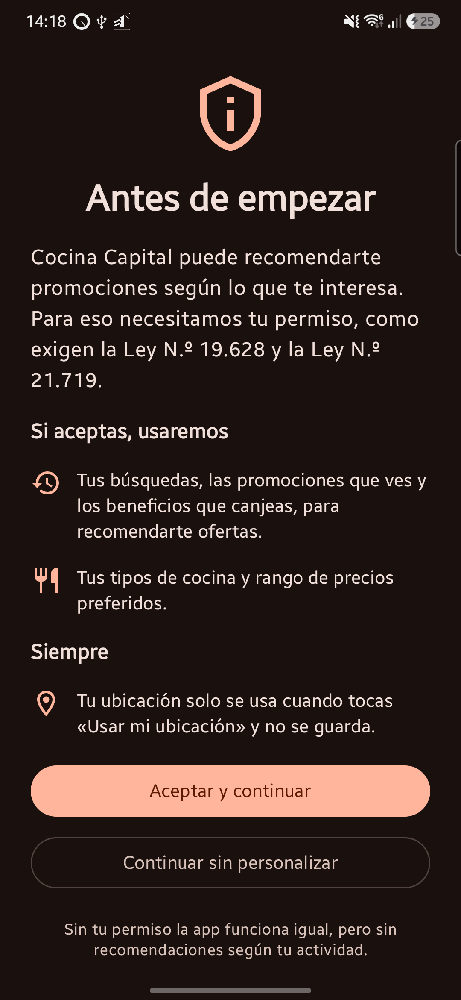
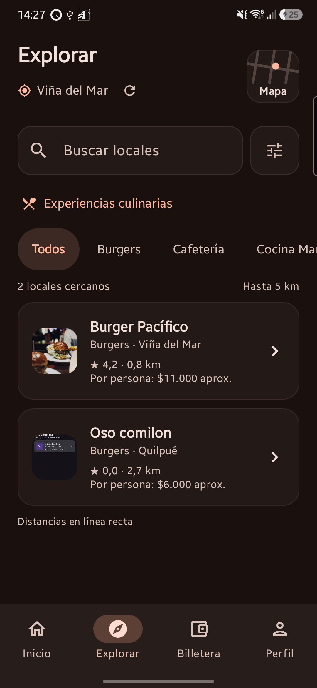
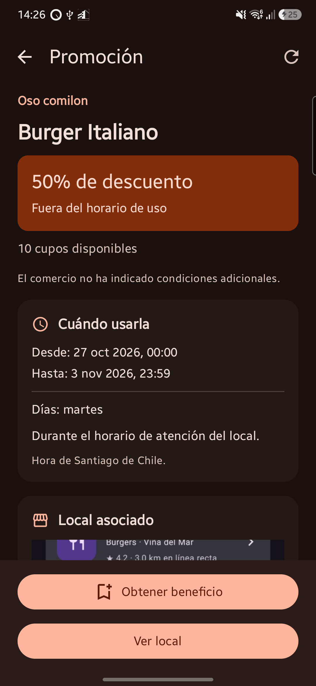
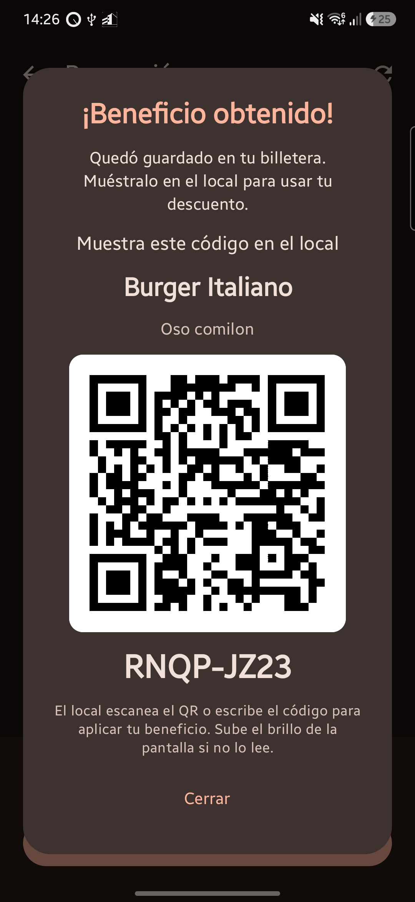
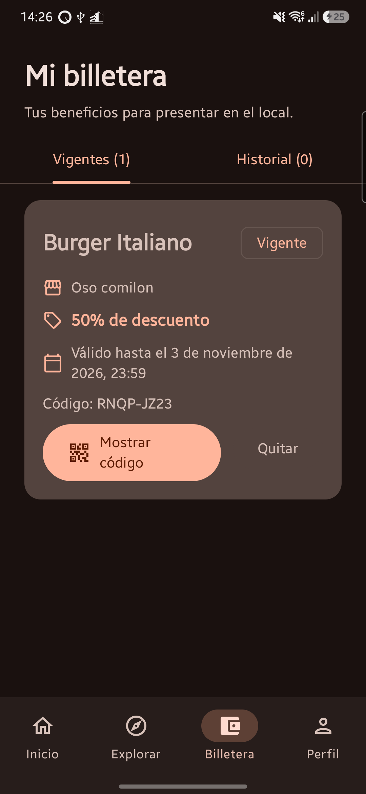
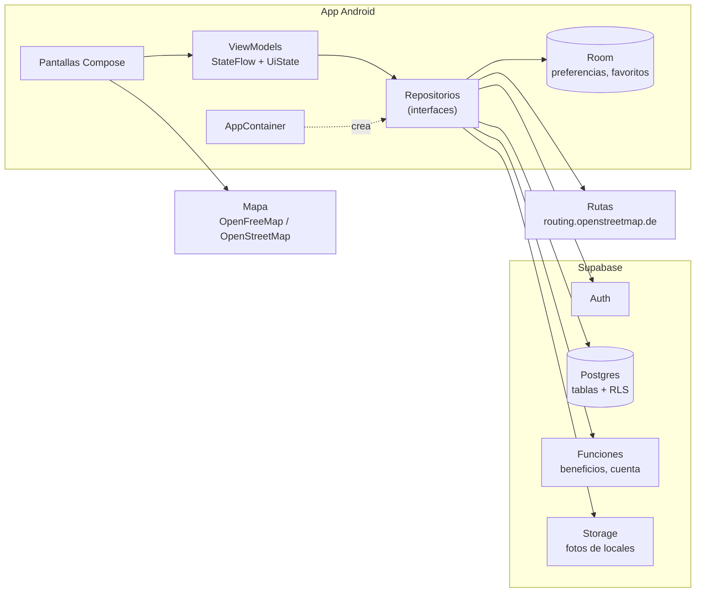
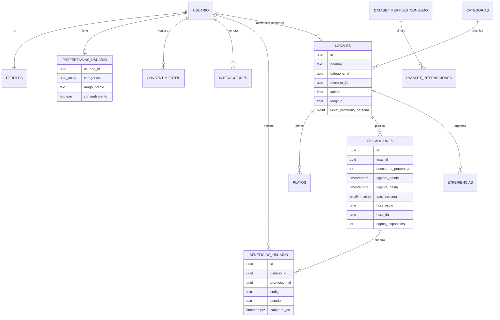
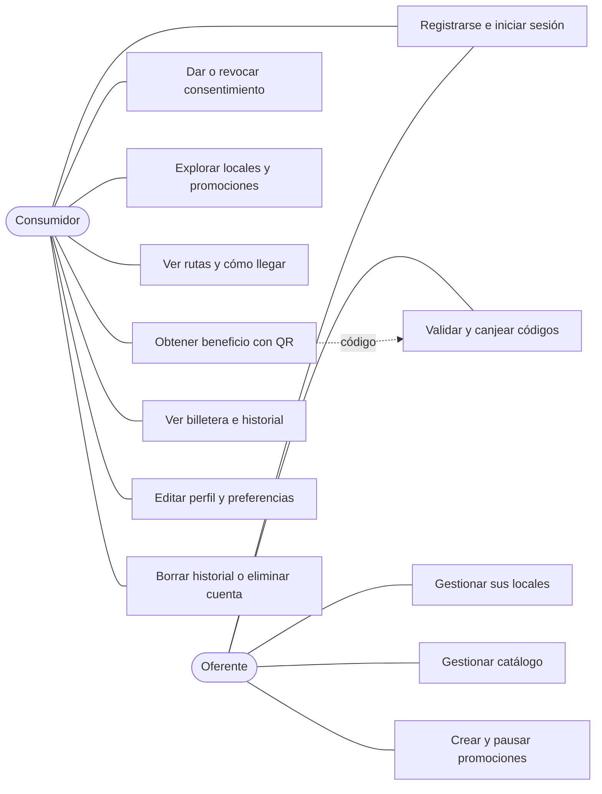

# Cocina Capital

Aplicación Android que conecta a los consumidores con locales gastronómicos de Valparaíso y Viña del Mar. Muestra locales, promociones vigentes (pensadas para las horas de baja demanda) y experiencias culinarias; permite obtener beneficios con código QR y canjearlos en el local. Los locales tienen su propio portal para publicar su catálogo y sus promociones y validar los canjes.

Proyecto de la asignatura **DSY1105** (Duoc UC). Todos los datos de prueba son ficticios.

## Integrantes

| Nombre | GitHub |
|---|---|
| Maximiliano Valenzuela | [maxvalenzuelaDev](https://github.com/maxvalenzuelaDev) |
| Benjamin Avendano | [NevanXll](https://github.com/NevanXll) |
| Miguel Delgado | [migueldelgado-nos](https://github.com/migueldelgado-nos) |

## Capturas

| Inicio de sesión | Consentimiento | Inicio |
|---|---|---|
|  |  |  |

| Explorar | Detalle de local | Detalle de promoción |
|---|---|---|
|  |  |  |

| Beneficio obtenido | Billetera |
|---|---|
|  |  |

## Funcionalidades

**Cuenta y privacidad**
- Registro e inicio de sesión con correo y contraseña (Supabase Auth). La sesión se mantiene al reabrir la app.
- Dos roles: consumidor y oferente. Cada uno ve su propia navegación.
- Antes del primer uso, el consumidor acepta o rechaza el uso de sus datos para personalizar (Ley N.º 19.628 y N.º 21.719). Puede cambiarlo en Perfil.
- Política de privacidad y términos de uso dentro de la app.
- Desde Perfil se puede borrar el historial de actividad o eliminar la cuenta con todos sus datos.

**Consumidor**
- **Inicio:** categorías de cocina, sección "Para ti" y promociones vigentes.
- **Explorar:** locales cercanos por GPS o por zona, búsqueda, filtros (radio, presupuesto por persona, cocinas preferidas), mapa y rutas a pie o en auto.
- **Detalle de local:** foto, valoración, horario, dirección con "Cómo llegar" (Google Maps), menú destacado y promociones activas.
- **Detalle de promoción:** descuento, vigencia, días y franja horaria (hora de Chile), cupos y condiciones.
- **Experiencias culinarias:** degustaciones y menús temáticos de los locales.
- **Billetera:** "Obtener beneficio" descuenta un cupo y entrega un código único con QR para mostrar en el local. Vigentes e historial de canjeados y vencidos. Quitar un beneficio libera el cupo.
- **Perfil:** foto (cámara o galería), nombre, cocinas preferidas, rango de precios, avisos, tema claro u oscuro y favoritos. Las preferencias se sincronizan con Supabase y aparecen al iniciar sesión en otro teléfono.

**Oferente (portal del local)**
- **Mis locales:** uno o varios locales, con ubicación por GPS y foto de portada.
- **Catálogo:** platos con precio y destacados.
- **Promociones:** crear, editar, pausar, reanudar y finalizar, con vigencia, días, franja horaria y cupos.
- **Canjear:** escanea el QR del cliente (o escribe el código), revisa si está válido, vencido, ya canjeado o fuera de horario, y confirma el canje.

**Datos para pruebas**
- Catálogo ficticio de locales, platos, promociones y experiencias.
- Dataset anonimizado de 40 perfiles de consumo y sus interacciones, para probar recomendaciones sin datos reales.

**Pendiente** (tablero de Trello): recomendaciones personalizadas (HU-21, HU-24), notificaciones de promociones (HU-22), métricas del oferente (HU-30) y modo sin conexión (HU-35).

## Tecnologías

Kotlin · Jetpack Compose y Material 3 · MVVM con `StateFlow` · Navigation Compose · [Supabase](https://supabase.com) (Auth, Postgres con RLS y funciones, Storage) con `supabase-kt` · Room · Coil · ZXing (QR) · MapLibre y Leaflet (mapa) · JUnit y kotlinx-coroutines-test.

## Requisitos

- **Android Studio** reciente (Android Gradle Plugin 8.13; el wrapper de Gradle se descarga solo).
- **JDK 17.** El que trae Android Studio sirve.
- Teléfono o emulador con **Android 8.0 (API 26) o superior**, con internet.
- Un proyecto de **Supabase** (el plan gratuito alcanza).

## Cómo ejecutar

### 1. Clonar y abrir

```bash
git clone https://github.com/maxvalenzuelaDev/AppCocinaCapital.git
```

Abre la carpeta en Android Studio y espera a que termine la sincronización de Gradle.

### 2. Preparar Supabase

En **SQL Editor** ejecuta, en este orden, [`supabase/schema.sql`](supabase/schema.sql) y luego los archivos de [`supabase/migraciones/`](supabase/migraciones). El orden importa: el nombre de los archivos no siempre coincide con él.

| # | Archivo | Qué agrega |
|---|---|---|
| 1 | `schema.sql` | Tablas del catálogo, billetera y preferencias, lectura pública y datos de prueba |
| 2 | `2026-10-26_t04_perfiles_roles_y_local_oferente.sql` | Perfiles con rol, dueño de cada local y permisos del oferente |
| 3 | `2026-10-27_varios_locales_por_oferente.sql` | Varios locales por oferente |
| 4 | `2026-10-27_hu27_promociones_oferente.sql` | Días, franja horaria y cupos de las promociones |
| 5 | `2026-10-27_t05_storage_fotos_locales.sql` | Bucket `locales` para las fotos |
| 6 | `2026-10-27_permisos_funciones_oferente.sql` | Permisos de las funciones anteriores |
| 7 | `2026-10-27_hu09_experiencias_culinarias.sql` | Experiencias culinarias |
| 8 | `2026-10-28_t02_beneficios_usuario.sql` | Código, estado y RLS de los beneficios |
| 9 | `2026-10-28_t03_rpc_beneficios.sql` | Funciones para obtener, quitar, listar y canjear beneficios |
| 10 | `2026-10-28_t06_preferencias_y_consentimientos.sql` | Preferencias y consentimientos en Supabase |
| 11 | `2026-10-28_hu20_t07_interacciones_y_cuenta.sql` | Interacciones, borrar historial y eliminar cuenta |
| 12 | `2026-10-28_hu34_dataset_perfiles_consumo.sql` | Tablas del dataset de perfiles de consumo |

Las migraciones `2026-10-24_hu07_*` y `2026-10-25_hu08_*` solo hacen falta en bases creadas con una versión anterior de `schema.sql`.

Datos de prueba opcionales (también en `supabase/`):
- `dataset_perfiles_consumo.sql`: carga los 40 perfiles y sus interacciones.
- `experiencia_de_prueba.sql`: publica una experiencia de ejemplo.
- `fotos_locales_de_prueba.sql`: asigna fotos a los locales de prueba.
- `asignar_oferente.sql`: convierte una cuenta en oferente (el registro crea consumidores).

Para revisar que las funciones responden bien, ejecuta `verificar_t03_beneficios.sql` y `verificar_hu20_t07.sql`. No dejan datos: terminan con un error a propósito que revierte todo y muestran el resultado en el mensaje.

Por último, en **Authentication → Sign In / Providers → Email** deja activado el acceso con correo. Para probar, puedes desactivar **Confirm email**: el servicio de correo incluido en Supabase permite muy pocos envíos por hora.

### 3. Configurar las credenciales

Copia [`local.properties.example`](local.properties.example) a `local.properties` (en la raíz del proyecto) y completa los datos de **Project Settings → API**:

```properties
SUPABASE_URL=https://TU-PROYECTO.supabase.co
SUPABASE_ANON_KEY=tu-clave-anon
```

- Usa la clave **anon / public**, nunca la `service_role`.
- `local.properties` está en el `.gitignore` y **no se sube** a GitHub.
- Después de cambiar las credenciales, haz **Build → Rebuild Project**, porque se copian al compilar.

### 4. Ejecutar

Elige el dispositivo y presiona **Run ▶** en Android Studio, o desde la terminal:

```bash
./gradlew installDebug                          # instala en el dispositivo conectado
./gradlew assembleDebug testDebugUnitTest       # compila y ejecuta las pruebas unitarias
```

En Windows usa `gradlew.bat` en lugar de `./gradlew`.

### 5. APK firmado (release)

El APK de entrega se firma con un keystore que **no está en el repositorio**. Agrega sus datos a `local.properties`:

```properties
RELEASE_STORE_FILE=C:/ruta/al/cocina-capital-release.jks
RELEASE_STORE_PASSWORD=...
RELEASE_KEY_ALIAS=cocina-capital
RELEASE_KEY_PASSWORD=...
```

```bash
./gradlew assembleRelease    # app/build/outputs/apk/release/app-release.apk
```

El release usa R8 para reducir el código; las reglas están en `app/proguard-rules.pro`. Sin esos datos el APK release se genera sin firmar y la versión de depuración funciona igual. Un teléfono con la versión de depuración instalada debe desinstalarla antes de instalar el release (las firmas son distintas).

## Arquitectura

- **MVVM:** cada pantalla tiene un `ViewModel` que expone un `StateFlow` con su `UiState` (cargando, éxito, error). Los composables solo dibujan el estado y envían acciones.
- **Repositorios con interfaz:** la UI no sabe de dónde vienen los datos. Las pruebas usan versiones en memoria.
- **Inyección manual:** las dependencias se crean en `di/AppContainer.kt`, sin Hilt.
- **Reglas en el servidor:** las políticas RLS de Supabase limitan qué filas puede leer o escribir cada cuenta. Las acciones con varias reglas (obtener y canjear beneficios, eliminar la cuenta) son funciones de Postgres que se ejecutan en una sola transacción.
- **Datos locales:** Room guarda preferencias, favoritos y la ruta de la foto de perfil. Las preferencias se suben a Supabase en segundo plano. Al cambiar el esquema se sube la versión y se agrega una migración (hoy, versión 4).



### Modelo de datos



`USUARIO` es `auth.users` de Supabase. Al eliminar una cuenta se borran en cascada su perfil, preferencias, consentimientos, beneficios e interacciones; sus locales quedan sin dueño.

### Casos de uso



### Carpetas

```text
app/src/main/java/com/cocinacapital/app/
├── data/
│   ├── auth/         Login (LoginRepository, AuthGateway) y sesión del Perfil (PerfilSesion)
│   ├── local/        Room (CocinaDatabase, DAOs, entidades), foto de perfil, lector de QR
│   ├── location/     Ubicación del teléfono
│   ├── model/        Modelos (LocalGastronomico, Promocion, BeneficioUsuario, Perfil…)
│   ├── remote/       SupabaseProvider y cliente HTTP de rutas
│   └── repository/   Repositorios: catálogo, detalle, billetera y canje, preferencias,
│                     interacciones y cuenta, oferente, rutas
├── di/               AppContainer
├── ui/
│   ├── auth/         AppEntry, Login y su ViewModel
│   ├── registro/     Registro de consumidores
│   ├── consentimiento/  Pantalla previa al primer uso
│   ├── home/         Inicio y sus componentes
│   ├── explore/      Explorar, filtros, mapa y rutas
│   ├── detalle/      Detalle de local y de promoción
│   ├── experiencias/ Experiencias culinarias
│   ├── billetera/    Billetera, botón de obtener beneficio y QR
│   ├── perfil/       Perfil, foto y diálogos
│   ├── oferente/     Portal del oferente: locales, catálogo, promociones y canje
│   ├── legal/        Política de privacidad y términos de uso
│   ├── navigation/   MainScaffold, barra inferior y rutas
│   ├── components/   Componentes compartidos
│   └── theme/        Tema de Cocina Capital
└── util/             Utilidades (distancia, fechas, QR)
location/             Módulo de ubicación (LocationManager de Android, sin Google Play Services)
supabase/             schema.sql, migraciones, datos de prueba y scripts de verificación
docs/capturas/        Capturas del README
```

## Pruebas

`./gradlew testDebugUnitTest` ejecuta 287 pruebas unitarias (ViewModels, repositorios, reglas de vigencia, sincronización de preferencias, códigos y QR). Las funciones de Supabase se prueban con los scripts `supabase/verificar_*.sql`.

## Cómo contribuir

1. Toma una tarjeta del tablero de Trello y muévela a **En curso**.
2. Crea una rama desde `max-branch` con el formato `feat/<id-tarjeta>-<tema>`, por ejemplo `feat/hu-13-beneficios`. Nunca trabajes directo en `main`.
3. Sigue los patrones del proyecto (ViewModel + `UiState`, repositorio con interfaz, dependencias en `AppContainer`) y deja los textos en `res/values`.
4. Si cambias la base de datos, agrega una migración en `supabase/migraciones/` y actualiza `schema.sql` y la tabla de arriba.
5. Antes de subir, ejecuta `./gradlew assembleDebug testDebugUnitTest` sin errores.
6. Escribe commits en español, técnicos y específicos (no "cambios" ni "fix").
7. Integra tu rama en `max-branch`, pide revisión a otro integrante y mueve la tarjeta a **En revisión**. `max-branch` se lleva a `main`.

## Problemas comunes

- **"No se pudo conectar":** revisa que el emulador tenga internet (abre una página en Chrome) y que `local.properties` tenga la URL y la clave correctas.
- **La app se cierra al abrirla después de cambiar de rama** (`A migration from 4 to 3 was required` o similar): el teléfono tiene una base local más nueva que la del código. Borra los datos de la app (*Ajustes → Aplicaciones → Cocina Capital → Almacenamiento → Borrar datos*).
- **"Se alcanzó el límite de envío de correos":** es el límite del correo incluido en Supabase. Desactiva **Confirm email** para probar o configura un servidor SMTP propio.
- **`INSTALL_FAILED_UPDATE_INCOMPATIBLE`:** el teléfono tiene la app firmada con otra clave (depuración o release). Desinstálala antes de instalar la otra versión.
- **Obtener un beneficio falla en una base nueva:** revisa que ejecutaste las migraciones 8 y 9 en orden.
