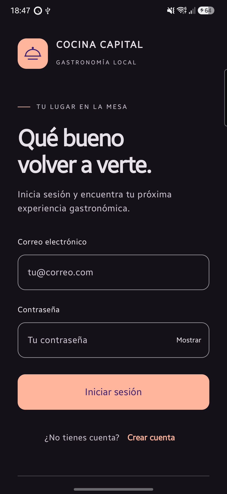
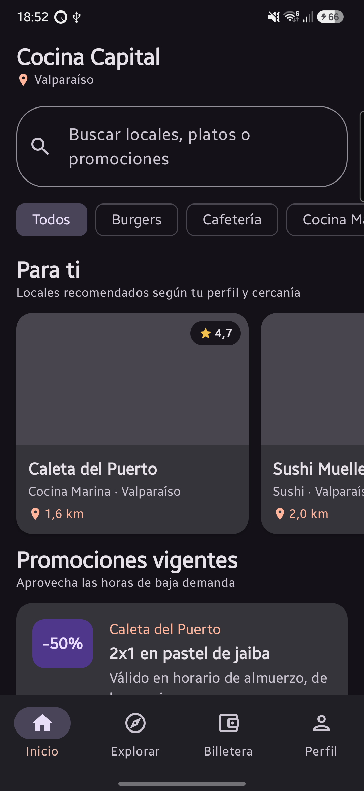
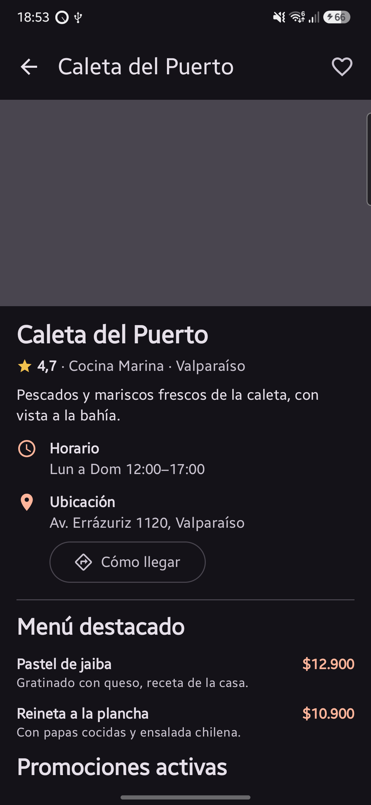

# Cocina Capital

Aplicación Android que conecta a los consumidores con locales gastronómicos de Valparaíso y Viña del Mar: muestra locales y promociones vigentes (pensadas para las horas de baja demanda), permite ver el detalle de cada local, guardar favoritos y personalizar las recomendaciones.

Proyecto de la asignatura **DSY1105** (Duoc UC). Todos los datos de prueba son ficticios.

## Integrantes

| Nombre | GitHub |
|---|---|
| Maximiliano Valenzuela | [maxvalenzuelaDev](https://github.com/maxvalenzuelaDev) |
| Benjamin Avendano | [NevanXll](https://github.com/NevanXll) |
| Miguel Delgado | [migueldelgado-nos](https://github.com/migueldelgado-nos) |

## Capturas

| Inicio de sesión | Home | Detalle de local |
|---|---|---|
|  |  |  |

## Funcionalidades

**Cuenta**
- Registro e inicio de sesión con correo y contraseña (Supabase Auth); la sesión se mantiene al reabrir la app.
- El Login da la bienvenida en el primer uso y "Qué bueno volver a verte" cuando ya hubo sesión en el teléfono.

**Catálogo**
- Home con categorías de cocina, búsqueda por texto, sección "Para ti" (valoración y cercanía) y promociones vigentes.
- Detalle de local: foto, valoración, descripción, horario, dirección con botón "Cómo llegar" (Google Maps), menú destacado con precios y promociones activas.
- Favoritos: el corazón del detalle guarda el local en el teléfono (Room) y aparece en el Perfil.

**Perfil**
- Foto de perfil con la cámara o la galería (permiso de cámara en tiempo de ejecución).
- Editar nombre, preferencias gastronómicas y rango de precios, notificaciones, consentimiento de datos personales (Ley N.º 21.719 y N.º 19.628) y tema claro, oscuro o del sistema.

**Experiencia**
- Animaciones: transición al detalle y entre pestañas, barra inferior, aparición y reacomodo de tarjetas al filtrar, mensajes del Login y corazón de favorito.

**En desarrollo:** mapa y ubicación real, detalle de promoción, beneficios con código QR, perfil del oferente y notificaciones. El avance está en el tablero de Trello del equipo.

## Tecnologías

Kotlin · Jetpack Compose y Material 3 · MVVM con `StateFlow` · Navigation Compose · [Supabase](https://supabase.com) (Auth y Postgres con `supabase-kt`) · Room · Coil · JUnit y kotlinx-coroutines-test.

## Requisitos

- **Android Studio** reciente (el proyecto usa Android Gradle Plugin 8.13 y Gradle 9.3; el wrapper de Gradle se descarga solo).
- **JDK 17.** El que trae Android Studio sirve.
- Teléfono o emulador con **Android 8.0 (API 26) o superior**, con internet.
- Un proyecto de **Supabase** (el plan gratuito alcanza).

## Cómo ejecutar

### 1. Clonar y abrir

```bash
git clone https://github.com/maxvalenzuelaDev/AppCocinaCapital.git
```

Abre la carpeta en Android Studio y espera a que termine la sincronización de Gradle.

### 2. Preparar Supabase

1. Crea un proyecto en Supabase.
2. En **SQL Editor**, ejecuta el contenido de [`supabase/schema.sql`](supabase/schema.sql). Crea las tablas (`categorias`, `locales`, `promociones`, `platos`), los permisos de lectura (RLS) y los datos de prueba.
   - Si tu base ya tenía una versión anterior del esquema, ejecuta en su lugar los archivos de [`supabase/migraciones/`](supabase/migraciones), en orden y **una sola vez** cada uno.
3. En **Authentication → Sign In / Providers → Email**, deja activado el acceso con correo. Para probar, puedes desactivar **Confirm email**: el servicio de correo incluido en Supabase permite muy pocos envíos por hora.

### 3. Configurar las credenciales

Copia [`local.properties.example`](local.properties.example) a `local.properties` (en la raíz del proyecto) y completa los datos de **Project Settings → API**:

```properties
SUPABASE_URL=https://TU-PROYECTO.supabase.co
SUPABASE_ANON_KEY=tu-clave-anon
```

- Usa la clave **anon / public**, nunca la `service_role`.
- `local.properties` está en el `.gitignore` y **no se sube** a GitHub.
- Después de cambiar las credenciales, haz **Build → Rebuild Project**, porque se copian al compilar.

### 4. Ejecutar

Elige el dispositivo y presiona **Run ▶** en Android Studio, o desde la terminal:

```bash
./gradlew installDebug                          # instala en el dispositivo conectado
./gradlew assembleDebug testDebugUnitTest       # compila y ejecuta las pruebas unitarias
```

En Windows usa `gradlew.bat` en lugar de `./gradlew`.

Para desarrollar sin Supabase, cambia `USE_FAKE_DATA` a `true` en `di/AppContainer.kt`: el catálogo usa datos ficticios locales (el inicio de sesión igual necesita Supabase).

## Arquitectura

- **MVVM:** cada pantalla tiene un `ViewModel` que expone un `StateFlow` con un `UiState` sellado (cargando, éxito, error). Los composables solo dibujan el estado y envían acciones; la lógica (por ejemplo, permisos o validaciones) vive en el ViewModel.
- **Repositorios con interfaz:** la UI no sabe de dónde vienen los datos. `HomeRepository` y `DetalleLocalRepository` tienen versión Supabase y versión Fake.
- **Inyección manual:** las dependencias se crean en `di/AppContainer.kt`, sin Hilt.
- **Datos locales:** Room guarda preferencias, favoritos y la ruta de la foto de perfil. Al cambiar el esquema se sube la versión y se agrega una migración.
- **Un solo cliente de Supabase:** `SupabaseProvider.client`, compartido por Login, Registro, Perfil y catálogo.

```text
app/src/main/java/com/cocinacapital/app/
├── data/
│   ├── auth/         Login (LoginRepository, AuthGateway) y sesión del Perfil (PerfilSesion)
│   ├── local/        Room (CocinaDatabase, DAOs, entidades), archivos de la foto, historial de sesión
│   ├── model/        Modelos (LocalGastronomico, Promocion, Plato, Perfil…)
│   ├── remote/       SupabaseProvider
│   └── repository/   Repositorios (Home, DetalleLocal, Preferencias, Favoritos, Auth)
├── di/               AppContainer
├── ui/
│   ├── auth/         AppEntry, Login y su ViewModel
│   ├── registro/     Registro de consumidores
│   ├── home/         Home y sus componentes
│   ├── detalle/      Detalle de local y de promoción
│   ├── perfil/       Perfil, foto y diálogos
│   ├── navigation/   MainScaffold, barra inferior y rutas
│   ├── components/   Componentes compartidos (BotonFavorito)
│   └── theme/        Tema de Cocina Capital
└── util/             Utilidades (distancia, formato)
supabase/             schema.sql y migraciones
docs/capturas/        Capturas del README
```

## Cómo contribuir

1. Toma una tarjeta del tablero de Trello y muévela a **En curso**.
2. Crea una rama desde `max-branch` con el formato `feat/<id-tarjeta>-<tema>`, por ejemplo `feat/t-24-animaciones`. Nunca trabajes directo en `main`.
3. Sigue los patrones del proyecto (ViewModel + `UiState`, repositorio con interfaz, dependencias en `AppContainer`) y deja los textos en `strings.xml`.
4. Antes de subir, ejecuta `./gradlew assembleDebug testDebugUnitTest` sin errores.
5. Escribe commits en español, técnicos y específicos (no "cambios" ni "fix").
6. Abre un Pull Request hacia `max-branch`, pide revisión a otro integrante y mueve la tarjeta a **En revisión**. `max-branch` se lleva a `main` con otro Pull Request.

## Problemas comunes

- **"No se pudo conectar":** revisa que el emulador tenga internet (abre una página en Chrome) y que `local.properties` tenga la URL y la clave correctas.
- **La app se cierra al abrirla después de cambiar de rama** (`A migration from 2 to 1 was required`): el teléfono tiene una base local más nueva que la del código. Borra los datos de la app (*Ajustes → Aplicaciones → CocinaCapital → Almacenamiento → Borrar datos*).
- **"Se alcanzó el límite de envío de correos":** es el límite del correo incluido en Supabase. Desactiva **Confirm email** para probar o configura un servidor SMTP propio.
